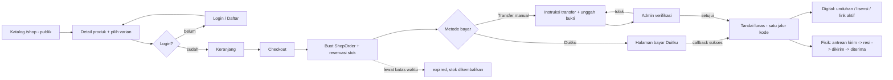
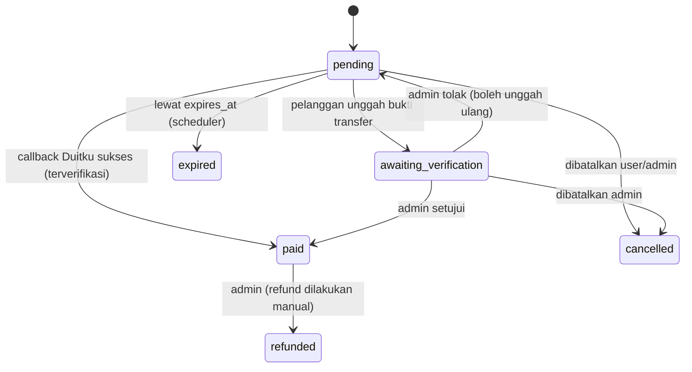

# Rencana Fitur Shop (E-Commerce Produk Digital & Fisik)

> Status: **diimplementasikan di branch `feature/shop`** (Fase 0–5 + persiapan Fase 7). Sisa: QA sandbox, go-live, dan integrasi API ongkir. Diperbarui: 9 November 2026.
> Tujuan dokumen: jadi acuan implementasi bertahap. Setiap fase punya checklist; centang saat selesai.

---

## 1. Tujuan

Menambah halaman **Toko** di website FKStudio sehingga situs tidak hanya menjual jasa pembuatan website/aplikasi (paket), tetapi juga:

- **Produk digital**: template, source code, e-book, aset desain, lisensi software, akses kelas/link. **Dirilis lebih dulu.**
- **Produk fisik**: barang yang dikirim lewat kurir. Struktur data dan alurnya disiapkan sejak awal, tetapi baru diaktifkan di fase terakhir.

Pembayaran lewat **Duitku** (otomatis) dan **transfer manual** (diverifikasi admin). Pesanan, invoice, PPN, dan pengiriman dikelola dari dashboard yang sama.

**Indikator selesai (rilis digital):**
1. Pengguna yang sudah login bisa melihat katalog, memilih varian, memasukkan ke keranjang, checkout, dan membayar via Duitku atau transfer manual.
2. Produk digital otomatis bisa diunduh/diakses setelah pembayaran lunas (Duitku: otomatis; manual: setelah admin menyetujui bukti transfer).
3. PPN tercatat per pesanan dan bisa dilihat admin, tetapi tidak tampil ke pelanggan.
4. Alur paket jasa yang sudah ada (DP, pelunasan, domain) tetap berjalan seperti sebelumnya.

**Indikator selesai (rilis fisik):** pelanggan memilih alamat dan ongkir saat checkout; admin mengisi resi; pelanggan melihat status pengiriman.

---

## 2. Keputusan yang Sudah Dikonfirmasi

| # | Topik | Keputusan |
|---|---|---|
| 1 | Menu | "Produk" (paket jasa) diganti jadi **"Paket"**, ditambah menu baru **"Toko"** di `/shop` |
| 2 | Login | **Keranjang dan checkout wajib login** (+ email terverifikasi). Katalog dan detail produk tetap publik |
| 3 | Produk fisik & ongkir | **Fokus produk digital dulu.** Skema, varian berat/stok, alamat, dan antarmuka ongkir disiapkan; integrasi ongkir (tarif flat + API RajaOngkir/Biteship) dikerjakan di fase fisik |
| 4 | Varian | **Masuk v1** (mis. ukuran/warna untuk fisik, Personal/Commercial atau Basic/Pro untuk digital) |
| 5 | PPN | Harga sudah termasuk PPN. **PPN tidak ditampilkan ke pelanggan**, tetapi **dihitung, disimpan, dan ditampilkan di admin** (detail pesanan + laporan) |
| 6 | Batas unduhan | Default **5 kali** per pembelian, bisa diatur per produk |
| 7 | Urutan rilis | Digital dulu, fisik menyusul |
| 8 | Metode bayar | **Duitku + transfer manual** (rekening bank & QRIS yang sudah diatur di dashboard) |

---

## 3. Temuan dari Kode Saat Ini

| Temuan | Lokasi | Dampak ke rencana |
|---|---|---|
| URL `/products` dan menu navbar "Produk" sudah dipakai untuk **paket jasa** | `routes/web.php` (`package.index`), `components/site/navbar.blade.php`, `footer.blade.php` | Shop memakai `/shop`; label menu paket diganti "Paket". URL `/products` dibiarkan agar link lama tidak rusak |
| Model `Product`, `Order`, `OrderItem` ada, **tanpa migrasi/tabel**, tidak dipakai di mana pun | `app/Models/` | Hapus `Order`/`OrderItem`, tulis ulang `Product` dengan skema baru |
| Callback Duitku hanya mencari `PackageOrder::find($merchantOrderId)` | `DuitkuController::callback` | Perlu dispatcher berdasarkan prefix order ID |
| `returnUrl` di-hardcode ke `checkout.success` | `DuitkuService::createInvoice` | Jadikan parameter |
| Callback tidak idempoten, tidak cek nominal, signature dibandingkan dengan `===` | `DuitkuController`, `DuitkuService::validateCallback` | Perbaiki sebelum shop live (stok & lisensi tidak boleh diproses dua kali) |
| Konfigurasi Duitku dibaca via `env()` langsung di service | `DuitkuService::__construct` | Pindah ke `config/services.php`; `env()` bernilai null setelah `config:cache` |
| Transfer manual paket: bukti diunggah ke disk **publik** lewat `Ticket`, admin mengubah status sendiri | `CheckoutController::confirmPayment`, `CmsController::updateOrderStatus` | Shop memakai alur verifikasi tersendiri, bukti disimpan di disk privat |
| Rekening bank (`payment_methods`) & QRIS (`invoice_qris`) sudah diatur di `site_settings` | `CmsController::editPaymentMethods` | Dipakai ulang untuk transfer manual shop |
| Voucher `used_count` dinaikkan saat checkout, sebelum bayar | `CheckoutController::process` | Untuk shop, naikkan saat pesanan **lunas** |
| Media dilayani via share **publik** Nextcloud | `HasMediaUrl::getUrl` | File produk digital & bukti transfer **tidak boleh** disimpan di jalur ini |
| Sudah ada: `InvoiceNumbering`, `InvoicePdf`, `InvoiceWhatsApp`, `WahaClient`, antrean `database`, scheduler | `app/Services/`, `routes/console.php` | Dipakai ulang untuk invoice & notifikasi shop |
| `MAIL_MAILER=log` | `.env` | Email ke pelanggan belum benar-benar terkirim; perlu SMTP sebelum go-live |
| Konten dua bahasa memakai kolom `_id` / `_en` + trait `HasTranslations` | `app/Traits/HasTranslations.php` | Produk, varian, dan kategori mengikuti pola yang sama |
| Harga paket disimpan sebagai string lalu di-parse (`str_replace`) | `CheckoutController::process` | Shop memakai **integer rupiah** sejak awal |

---

## 4. Alur Besar



Duitku dan transfer manual **berakhir di action yang sama** (`MarkShopOrderPaid`), sehingga pengiriman produk digital, kenaikan `used_count` voucher, update invoice, dan notifikasi hanya ditulis sekali.

### Status pesanan

Dua status terpisah agar keranjang campuran (digital + fisik) tetap jelas:

- `payment_status`: `pending` → `awaiting_verification` (khusus manual) → `paid` | `expired` | `cancelled` | `refunded`
- `fulfillment_status`: `unfulfilled` → `processing` → `shipped` → `delivered`, atau langsung `fulfilled` bila semua item digital



Pesanan berstatus `awaiting_verification` **tidak** di-expire otomatis, supaya pelanggan yang sudah transfer tidak kehilangan pesanannya.

---

## 5. Skema Database

Semua nominal rupiah memakai `unsignedBigInteger` (Duitku menerima integer). Semua teks yang tampil ke publik punya pasangan `_id` / `_en`.

### 5.1 Katalog

**`product_categories`**
`id, slug (unique), name_id, name_en, description_id, description_en, sort_order, is_active, timestamps`

**`products`** (info umum; harga/stok ada di varian)
| Kolom | Catatan |
|---|---|
| `id`, `product_category_id` (nullable, nullOnDelete) | |
| `type` | `digital` / `physical` |
| `slug` (unique) | |
| `name_id`, `name_en`, `short_description_id/en`, `description_id/en` | deskripsi berupa rich text, editor sama dengan blog |
| `has_variants` (bool) | `false` = produk hanya punya satu varian default yang tidak terlihat |
| `min_price`, `max_price` | cache dari varian aktif, untuk sortir katalog dan teks "mulai dari Rp…" |
| `digital_delivery` (nullable) | `file` / `license_key` / `link` |
| `access_url` (nullable, cast `encrypted`) | untuk `link` (mis. akses kelas, Notion, Drive) |
| `max_downloads` (default 5), `download_expiry_days` (nullable) | |
| `license_terms_id`, `license_terms_en` (nullable) | hak pakai produk digital |
| `is_active`, `is_featured`, `sort_order` | |
| `meta_title`, `meta_description` | SEO |
| `timestamps`, `softDeletes` | produk yang pernah terjual tidak dihapus permanen |

**`product_images`**: `id, product_id, path, alt_id, alt_en, sort_order` (boleh di Nextcloud/public seperti media lain).

### 5.2 Varian

Pola: **setiap produk selalu punya minimal satu varian.** Produk tanpa pilihan cukup punya satu varian default (`is_default = true`), sehingga keranjang, stok, dan pesanan selalu menunjuk ke varian. Kode jadi satu jalur, tidak bercabang "pakai varian / tidak".

**`product_options`**: `id, product_id, name_id, name_en, position` (mis. "Warna", "Ukuran", "Lisensi"; maksimal 3 opsi per produk)

**`product_option_values`**: `id, product_option_id, value_id, value_en, position` (mis. "Merah", "L", "Commercial")

**`product_variants`**
| Kolom | Catatan |
|---|---|
| `id`, `product_id` | |
| `sku` (nullable, unique) | |
| `title_id`, `title_en` | dibentuk otomatis dari nilai opsi, mis. "Merah / L" |
| `price`, `compare_at_price` (nullable) | harga sudah termasuk PPN; harga coret untuk promo |
| `stock` (nullable) | `null` = tak terbatas (default untuk digital) |
| `weight_grams` (nullable) | wajib untuk fisik, dipakai hitung ongkir |
| `product_image_id` (nullable) | gambar yang tampil saat varian dipilih |
| `is_default`, `is_active`, `position` | |
| `timestamps`, `softDeletes` | |

**`product_variant_option_value`** (pivot): `product_variant_id, product_option_value_id`

### 5.3 Aset digital

**`product_files`**: `id, product_id, product_variant_id (nullable = berlaku untuk semua varian), disk, path, original_name, mime, size, version_label, timestamps`. Disimpan di **disk privat** (lihat §8). Contoh: varian "Pro" mendapat file tambahan yang tidak didapat varian "Basic".

**`product_license_keys`**: `id, product_id, product_variant_id (nullable), key (encrypted), shop_order_item_id (nullable), assigned_at (nullable), timestamps`.

### 5.4 Keranjang

**`cart_items`**: `id, user_id, product_variant_id, quantity, timestamps`, unique `(user_id, product_variant_id)`.
Disimpan di database (bukan session) karena keranjang wajib login; isinya ikut ke semua perangkat pengguna.

### 5.5 Pesanan

**`shop_orders`**
| Kolom | Catatan |
|---|---|
| `id`, `order_number` (unique) | format `SO-YYYYMMDD-XXXX` |
| `user_id` | |
| `payment_status`, `fulfillment_status` | lihat §4 |
| `payment_channel` | `duitku` / `manual` |
| `customer_name`, `customer_email`, `customer_phone` | snapshot saat checkout |
| `shipping_address` (json, nullable) | snapshot alamat, bukan FK |
| `courier_code`, `courier_service`, `shipping_cost`, `tracking_number`, `shipped_at`, `delivered_at` | hanya untuk pesanan berisi barang fisik |
| `subtotal`, `discount_amount`, `voucher_code`, `unique_code` (nullable), `total_amount` | dihitung di server; `unique_code` lihat §7 |
| `tax_rate`, `tax_base`, `tax_amount` | **PPN internal, hanya tampil di admin** (lihat §6) |
| `invoice_id` (nullable) | relasi ke `invoices` yang sudah ada |
| `paid_at`, `expires_at`, `notes`, `admin_notes`, `timestamps` | |

**`shop_order_items`**: `id, shop_order_id, product_id (nullable, nullOnDelete), product_variant_id (nullable, nullOnDelete), product_type, product_name, variant_title, sku, unit_price, quantity, subtotal, weight_grams`. Nama, varian, dan harga di-snapshot.

**`shop_payments`** (satu pesanan bisa punya beberapa percobaan bayar)
| Kolom | Catatan |
|---|---|
| `id`, `shop_order_id` | |
| `channel` | `duitku` / `manual` |
| `merchant_order_id` (unique, nullable) | khusus Duitku, mis. `SO-20261109-0001-1` |
| `method_code` | kode metode Duitku, atau ID rekening/QRIS untuk manual |
| `amount`, `reference`, `payment_url` | |
| `status` | `pending` / `submitted` / `success` / `rejected` / `failed` / `expired` |
| `proof_path`, `proof_disk`, `submitted_at` | bukti transfer manual (disk privat) |
| `sender_name`, `sender_bank`, `customer_note` | diisi pelanggan saat unggah bukti |
| `verified_by`, `verified_at`, `rejection_reason` | diisi admin |
| `raw_callback` (json), `paid_at`, `timestamps` | |

> Dengan tabel ini, kalau link Duitku kedaluwarsa dan pelanggan ingin bayar ulang (atau pindah ke transfer manual), dibuat percobaan baru tanpa bentrok `merchantOrderId`. Semua callback dan bukti transfer tercatat untuk audit.

**`digital_entitlements`** (hak akses produk digital)
`id, user_id, shop_order_item_id, product_id, product_variant_id, product_license_key_id (nullable), download_count, max_downloads, expires_at (nullable), revoked_at (nullable), timestamps`

**`user_addresses`** (disiapkan sekarang, dipakai di fase fisik)
`id, user_id, label, recipient_name, phone, province, city, district, postal_code, address_line, shipping_area_id (ID area dari API ongkir), is_default, timestamps`

### 5.6 Perubahan tabel yang sudah ada

- `vouchers`: tambah `scope` (`all` / `package` / `shop`, default `all`) dan `min_purchase` (nullable).
- `site_settings`:
  - `shop_enabled` (bool): menu & halaman toko tampil/tidak
  - `shop_physical_enabled` (bool, default `false`): produk fisik tampil dan bisa dibeli; dinyalakan di fase fisik
  - `shop_tax_rate` (decimal, default sama dengan `tax_rate` saat ini)
  - `shop_order_expiry_minutes` (default 1440) dan `shop_manual_expiry_minutes` (default 1440)
  - `shop_manual_payment_enabled` (bool), `shop_manual_unique_code` (bool)
  - `shop_origin_area_id`, `shop_origin_address`, `shop_flat_shipping_cost` (nullable): untuk fase fisik

### 5.7 Pembersihan

- Hapus `app/Models/Order.php` dan `app/Models/OrderItem.php` (tidak punya tabel, tidak dipakai).
- Tulis ulang `app/Models/Product.php` sesuai skema baru.

---

## 6. PPN (Internal, Hanya Admin)

Harga yang dilihat pelanggan **sudah termasuk PPN**, dan PPN **tidak muncul** di mana pun di sisi pelanggan: halaman produk, keranjang, checkout, halaman pesanan, invoice PDF, email, maupun WhatsApp.

**Perhitungan** (saat order dibuat, disimpan sebagai snapshot):
```
dasar         = subtotal barang - diskon          (ongkir & kode unik tidak dikenai)
tax_amount    = round(dasar × tarif / (100 + tarif))
tax_base (DPP)= dasar - tax_amount
```
Contoh tarif 11%: barang Rp 111.000 → DPP Rp 100.000, PPN Rp 11.000. Pelanggan hanya melihat Rp 111.000.

**Di admin:**
- Detail pesanan menampilkan DPP, tarif, dan PPN.
- Daftar pesanan punya kolom PPN (bisa disembunyikan).
- **Laporan PPN**: filter per bulan, hanya pesanan `paid`, total DPP & PPN, ekspor CSV.
- Pesanan yang di-refund dikeluarkan dari laporan.

**Invoice ke pelanggan** dibuat dengan baris pajak nol, sehingga yang tercetak hanya total. Angka PPN tetap tersimpan di `shop_orders`.

> Catatan: jika ada pembeli badan usaha yang meminta faktur pajak, untuk v1 ditangani manual di luar sistem. Perlakuan PPN (tarif, apakah ongkir ikut dikenai) sebaiknya dikonfirmasi ke konsultan pajak; tarif bisa diubah di pengaturan tanpa ubah kode.

---

## 7. Pembayaran

### 7.1 Duitku (refactor dulu)

Dikerjakan **sebelum** shop dibuat, dan harus tetap lolos untuk alur paket.

1. **Konfigurasi**: tambah blok `duitku` di `config/services.php` (`merchant_code`, `api_key`, `sandbox`); service membaca `config()` bukan `env()`.
2. **`returnUrl` & `callbackUrl` sebagai parameter** di `DuitkuService::createInvoice`; default tetap seperti sekarang untuk paket.
3. **Dispatcher callback**: `DuitkuController::callback` memeriksa prefix `merchantOrderId`:
   - `SO-...` → `ShopPaymentHandler`
   - selain itu → logika `PackageOrder` yang sekarang (dipindah apa adanya ke `PackageOrderPaymentHandler`).
4. **Keamanan callback (untuk keduanya)**:
   - Bandingkan signature dengan `hash_equals`.
   - Cocokkan `amount` callback dengan nominal yang tersimpan; kalau beda, tolak dan catat log.
   - **Idempoten**: kunci baris order (`lockForUpdate`) dalam transaksi; kalau sudah `paid`, kembalikan `200 OK` tanpa memproses ulang.
   - Verifikasi ulang ke API **Check Transaction Status** Duitku sebelum menandai lunas.
5. **Halaman kembali (`returnUrl`)** hanya **menampilkan** status, tidak pernah menandai lunas. Halaman ini melakukan polling ringan (tiap 5 detik, maksimal 1 menit).
6. Kirim `itemDetails` ke Duitku (opsional); jumlahnya harus sama persis dengan `paymentAmount`.

> Metode bayar tertentu di Duitku punya nominal minimum. Daftar metode sudah diambil berdasarkan nominal (`getPaymentMethods($amount)`), jadi metode yang tidak tersedia otomatis tidak tampil.

### 7.2 Transfer manual

Memakai rekening bank dan QRIS yang sudah diatur di **Dashboard → Metode Pembayaran**. Bisa dimatikan lewat `shop_manual_payment_enabled`.

**Sisi pelanggan:**
1. Di checkout memilih "Transfer Bank / QRIS".
2. Halaman pesanan menampilkan nominal persis, daftar rekening/QRIS, batas waktu, dan tombol salin nomor rekening & nominal.
3. Pelanggan mengunggah bukti (JPG/PNG/PDF, maks 2 MB) + nama pengirim & bank asal → `payment_status = awaiting_verification`.
4. Kalau ditolak, pelanggan melihat alasannya dan bisa mengunggah ulang sebelum batas waktu.

**Sisi admin:**
- Tab **"Menunggu Verifikasi"** di daftar pesanan, dengan badge jumlah di sidebar.
- Pratinjau bukti (di-stream dari disk privat, hanya untuk admin), nominal yang diharapkan, dan data pengirim.
- **Setujui** → `MarkShopOrderPaid` (jalur yang sama dengan Duitku). **Tolak** → wajib isi alasan, pelanggan diberi tahu.
- Admin mendapat notifikasi WhatsApp saat ada bukti baru.

**Kode unik (opsional, `shop_manual_unique_code`)**: menambahkan Rp 1–999 ke total supaya mutasi rekening mudah dicocokkan. Tampil ke pelanggan sebagai "Kode unik" dan tidak dikenai PPN.

**Alur ini terpisah dari sistem Ticket** yang dipakai paket jasa, dan bukti transfer tidak disimpan di disk publik.

---

## 8. Produk Digital

### Penyimpanan
- File produk disimpan di **disk privat** (`storage/app/private/shop-files`), **bukan** share publik Nextcloud. Jika nanti ingin di Nextcloud, gunakan folder yang tidak dibagikan publik dan stream lewat aplikasi.
- Validasi unggahan: whitelist ekstensi (zip, pdf, epub, psd, fig, mp4, dll.), batas ukuran dikonfigurasi (sesuaikan `upload_max_filesize` / `post_max_size` server).

### Pengiriman setelah lunas
Dalam transaksi `MarkShopOrderPaid`:
- `file` → buat `digital_entitlements` per item; file yang bisa diunduh = file umum produk + file khusus varian yang dibeli.
- `license_key` → ambil kunci yang belum terpakai untuk varian tersebut (`lockForUpdate`). Kalau kunci habis, pesanan tetap `paid`, ditandai "perlu tindakan", dan admin diberi tahu via WhatsApp.
- `link` → entitlement dibuat; `access_url` ditampilkan di halaman pembelian.
- Jika semua item digital: `fulfillment_status = fulfilled`.

### Unduhan
- Halaman **"Produk Digital Saya"** di akun pelanggan.
- Tombol unduh mengarah ke route yang memeriksa: login, kepemilikan, `revoked_at`, `expires_at`, `download_count < max_downloads` (default 5). Lalu redirect ke **temporary signed URL** (berlaku 10 menit) yang men-stream file via `Storage::download`.
- `download_count` naik setiap unduhan; rate limit per user.
- Admin bisa mereset jumlah unduhan atau mencabut akses (mis. setelah refund).

---

## 9. Produk Fisik (Disiapkan Sekarang, Diaktifkan Belakangan)

**Disiapkan di rilis digital:**
- Semua kolom fisik di skema (`weight_grams`, `stock` per varian, `shipping_*`, `user_addresses`).
- Admin sudah bisa membuat produk fisik beserta varian, stok, dan berat. Selama `shop_physical_enabled = false`, produk fisik tidak tampil di katalog dan tidak bisa masuk keranjang.
- Reservasi stok berlaku untuk semua varian yang `stock`-nya tidak null (dipakai juga oleh produk digital berkuota, mis. kursi kelas terbatas).
- Kontrak `ShippingRateProvider` (interface) dan bagian alamat/ongkir di checkout sudah ada strukturnya, tetapi hanya muncul bila keranjang berisi barang fisik.

**Dikerjakan di fase fisik:**
- **Alamat**: buku alamat di akun; checkout memilih/menambah alamat.
- **Ongkir**: `FlatRateProvider` (tarif flat dari pengaturan) lebih dulu, lalu provider API (RajaOngkir/Komerce atau Biteship; pilih setelah cek harga & dokumentasi terbaru). Endpoint AJAX `POST /shop/checkout/shipping-rates` menghitung dari total berat dan area tujuan; hasil dicache singkat. Ongkir **dihitung ulang di server** saat submit.
- **Pengiriman**: admin mengisi kurir + nomor resi → `shipped` (pelanggan diberi tahu) → `delivered` (manual oleh admin).

**Stok (berlaku sejak rilis digital):**
- Direservasi saat order dibuat dengan update atomik (`UPDATE ... SET stock = stock - ? WHERE id = ? AND stock >= ?`) agar tidak oversell. Dikembalikan saat `expired` / `cancelled`.
- Command `shop:expire-orders` dijadwalkan tiap 5 menit; order `pending` yang lewat `expires_at` jadi `expired` dan stoknya dikembalikan. Order `awaiting_verification` dilewati.
- **Kasus tepi**: callback sukses datang setelah order `expired`. Coba reservasi ulang stok; kalau habis, order tetap `paid` dan ditandai "perlu tindakan" (refund/restock).

---

## 10. Halaman Publik & Rute

| Method | URL | Nama route | Akses |
|---|---|---|---|
| GET | `/shop` | `shop.index` | publik (filter kategori, tipe, cari, urutkan, paginasi) |
| GET | `/shop/{product:slug}` | `shop.show` | publik |
| GET | `/cart` | `cart.index` | auth + verified |
| POST / PATCH / DELETE | `/cart/items`, `/cart/items/{cartItem}` | `cart.*` | auth + verified, throttle |
| GET / POST | `/shop/checkout` | `shop.checkout`, `shop.checkout.process` | auth + verified |
| POST | `/shop/checkout/shipping-rates` | `shop.checkout.rates` | auth + verified, throttle (fase fisik) |
| GET | `/shop/orders/{order:order_number}` | `shop.orders.show` | auth, pemilik (status, instruksi bayar, returnUrl Duitku) |
| POST | `/shop/orders/{order}/pay` | `shop.orders.pay` | auth, pemilik (bayar ulang / ganti metode) |
| POST | `/shop/orders/{order}/payment-proof` | `shop.orders.proof` | auth, pemilik, throttle |
| GET | `/my-purchases` | `user.purchases` | auth |
| GET | `/my-downloads` | `user.downloads` | auth |
| GET | `/downloads/{entitlement}` | `user.downloads.get` | auth + signed |
| GET/POST/PATCH/DELETE | `/my-addresses` | `user.addresses.*` | auth (fase fisik) |

Rute statis (`/shop/checkout`, `/shop/orders/...`) didefinisikan **sebelum** `/shop/{product:slug}` agar tidak tertangkap wildcard.

**Tamu yang menekan "Tambah ke keranjang"**: diarahkan ke login dengan pesan "Masuk dulu untuk menambahkan ke keranjang", lalu dikembalikan ke halaman produk yang sama dengan varian & jumlah yang dipilih tadi (disimpan di session sebagai `pending_cart_item`) dan otomatis ditambahkan ke keranjang.

### View baru
- `landing/shop/index.blade.php`: katalog (grid produk, filter, empty state, "mulai dari Rp…" untuk produk bervarian)
- `landing/shop/show.blade.php`: galeri gambar (Swiper), pemilih varian (Alpine.js: harga, stok, dan gambar berubah sesuai varian; kombinasi habis/nonaktif dinonaktifkan), badge tipe, deskripsi, ketentuan lisensi
- `landing/shop/cart.blade.php`
- `landing/shop/checkout.blade.php`: ringkasan **tanpa baris PPN**, voucher, metode bayar (Duitku dari `components/site/payment-methods` + transfer manual), bagian alamat & ongkir hanya bila ada barang fisik
- `landing/shop/order.blade.php`: status pesanan, instruksi transfer + form unggah bukti, atau status Duitku
- `landing/user/purchases.blade.php`, `downloads.blade.php`, `addresses.blade.php`
- Komponen: `components/shop/product-card.blade.php`, `components/shop/variant-picker.blade.php`, `components/shop/cart-button.blade.php` (ikon keranjang + badge, hanya tampil saat login)

### Navigasi
- Navbar & footer: tambah **"Toko"/"Shop"**; ubah label "Produk" → **"Paket"/"Packages"** (footer: "Produk & Paket" → "Paket").
- Menu akun: tambah "Pembelian Saya" dan "Produk Digital Saya".
- Opsional: section "Produk Unggulan" di homepage (produk `is_featured`), bisa dimatikan dari CMS.

### Arah visual
Mengikuti sistem desain yang sudah ada (komponen `ui/*`, font Bricolage Grotesque + Hanken Grotesk) dan arahan merek: **kuning terang + biru muda, tanpa ungu/violet, tidak terlihat seperti template**. Semua teks tersedia ID/EN, dan semua halaman harus nyaman di layar ponsel.

---

## 11. Dashboard Admin

Grup menu baru **"Toko"** di sidebar (role `super_admin`), dengan controller terpisah (`ShopProductController`, `ShopCategoryController`, `ShopOrderController`, `ShopReportController`) agar `CmsController` yang sudah 900+ baris tidak makin besar.

- **Produk**: daftar + filter, buat/edit:
  - Field dua bahasa, tipe, kategori, gambar multi (urutan via SortableJS).
  - Toggle "Produk ini punya varian". Mati → satu form harga/stok/SKU/berat (varian default). Nyala → definisikan opsi & nilainya, sistem membuat kombinasi varian, lalu admin mengisi harga/stok/SKU/berat/gambar per varian dalam satu tabel (dengan "terapkan ke semua").
  - Digital: unggah file (umum atau per varian), impor kunci lisensi dari CSV (per varian), atau link akses; batas unduhan.
  - Aktif/nonaktif, duplikasi produk.
- **Kategori**: CRUD + urutan.
- **Pesanan Toko**: tab Semua / Menunggu Pembayaran / **Menunggu Verifikasi** / Lunas / Perlu Dikirim / Perlu Tindakan. Detail pesanan: item & varian, pembayaran (riwayat callback, bukti transfer), **DPP & PPN**. Aksi: setujui/tolak bukti transfer, isi resi & tandai dikirim/diterima (fase fisik), batalkan, tandai refund (cabut entitlement + kembalikan stok), kirim ulang link unduhan, catatan admin.
- **Laporan**: omzet, jumlah pesanan, produk terlaris, dan **Laporan PPN bulanan** (ekspor CSV).
- **Voucher**: tambah pilihan `scope` dan minimum belanja.
- **Pengaturan Toko**: aktif/nonaktif toko, aktif/nonaktif produk fisik, tarif PPN, transfer manual & kode unik, masa kedaluwarsa pesanan, (fase fisik) alamat asal & tarif flat.
- **Ringkasan dashboard**: omzet toko bulan ini, bukti transfer menunggu verifikasi, pesanan perlu dikirim, stok menipis, kunci lisensi hampir habis.

---

## 12. Invoice & Notifikasi

- **Invoice**: saat order dibuat, buat `Invoice` (status `Unpaid`, **pajak 0**) memakai `InvoiceNumbering::next()`, dengan baris per item + varian; saat lunas → `Paid`. PDF memakai `InvoicePdf`; pelanggan bisa mengunduh dari halaman pembelian.
- **Notifikasi** (lewat antrean `database` yang sudah ada). Isi pesan ke pelanggan **tidak** menyebut PPN.

| Kejadian | Pelanggan | Admin |
|---|---|---|
| Order dibuat (Duitku) | email + WA: link bayar & batas waktu | — |
| Order dibuat (manual) | email + WA: nominal, rekening, batas waktu | — |
| Bukti transfer diunggah | — | WA: ada bukti yang perlu diverifikasi |
| Bukti ditolak | email + WA: alasan & cara unggah ulang | — |
| Lunas | email + WA: invoice, link unduhan / info pengiriman | WA: ada pesanan baru |
| Dikirim (fase fisik) | email + WA: kurir & resi | — |
| Kunci lisensi habis / perlu tindakan | — | WA |

- WhatsApp memakai `WahaClient` yang sudah ada. Email butuh SMTP sungguhan (sekarang `MAIL_MAILER=log`).

---

## 13. SEO

- Schema.org `Product` + `Offer`/`AggregateOffer` (rentang harga untuk produk bervarian, `availability`) di halaman detail, lewat `App\Support\Seo` dan `components/seo/schema`.
- Tambahkan `/shop` dan semua produk aktif ke `sitemap.xml` dan `llms.txt`. Produk fisik baru masuk sitemap setelah `shop_physical_enabled` dinyalakan.
- Meta title/description per produk, fallback dari nama & deskripsi singkat.
- Gambar produk wajib punya `alt` (ID/EN).

---

## 14. Keamanan (Checklist)

- [x] Harga, diskon, ongkir, kode unik, PPN, dan total **selalu** dihitung ulang di server dari data varian.
- [x] Callback Duitku: `hash_equals`, cek nominal, idempoten, verifikasi status ke Duitku.
- [x] Persetujuan transfer manual hanya oleh admin, dicatat `verified_by` + waktu; persetujuan ganda tidak memproses ulang (idempoten di `MarkShopOrderPaid`).
- [x] File digital & bukti transfer di disk privat; unduhan lewat signed URL + cek kepemilikan + batas unduhan.
- [x] `access_url` dan kunci lisensi disimpan terenkripsi (`encrypted` cast).
- [x] Reservasi stok atomik per varian.
- [x] Rate limit: keranjang, checkout, unggah bukti, hitung ongkir, unduhan.
- [x] Policy/otorisasi: pelanggan hanya bisa melihat keranjang, pesanan, dan unduhan miliknya.
- [x] Validasi unggahan (ekstensi, ukuran) untuk file produk dan bukti transfer.
- [x] Data PPN tidak bocor ke view, JSON, PDF, atau notifikasi pelanggan (ada test-nya).
- [x] Callback Duitku tetap di `routes/api.php` (tanpa CSRF), rute lain tetap di `web`.

---

## 15. Pengujian

Feature test baru (PHPUnit, mengikuti pola `tests/Feature/Subscriptions/`), dengan `Http::fake()` untuk Duitku dan `Storage::fake()` untuk file:

- **Callback**: signature salah → 400; nominal beda → ditolak; callback ganda → diproses sekali; prefix `SO-` vs paket diarahkan ke handler yang benar.
- **Regresi alur paket**: DP, pelunasan, dan full payment tetap menandai `PackageOrder` & invoice dengan benar.
- **Transfer manual**: unggah bukti → `awaiting_verification`; setujui → lunas & entitlement dibuat; tolak → kembali `pending` dengan alasan; order `awaiting_verification` tidak di-expire; non-admin tidak bisa melihat bukti.
- **Login**: tamu tidak bisa akses keranjang/checkout; `pending_cart_item` ditambahkan setelah login.
- **Varian**: harga & stok diambil dari varian; varian nonaktif/habis tidak bisa masuk keranjang; produk tanpa varian memakai varian default; file khusus varian hanya untuk pembeli varian itu.
- **Stok**: dua checkout bersamaan untuk stok terakhir → hanya satu berhasil; order expired mengembalikan stok.
- **Digital**: unduhan ditolak untuk user lain, signature kedaluwarsa, atau melebihi 5 kali; kunci lisensi tidak pernah diberikan dua kali.
- **PPN**: perhitungan DPP/PPN benar (termasuk dengan diskon); PPN tidak muncul di halaman checkout, pesanan, invoice PDF pelanggan; muncul di detail pesanan admin & laporan.
- **Voucher**: `scope` shop vs package; `used_count` hanya naik saat lunas.
- **Produk fisik**: tidak tampil & tidak bisa dibeli saat `shop_physical_enabled = false`.
- **Halaman publik**: produk nonaktif → 404; produk aktif muncul di sitemap.

Uji end-to-end manual di **sandbox Duitku** (VA, QRIS, e-wallet) dan alur transfer manual sebelum go-live.

---

## 16. Tahapan Eksekusi

Setiap fase dikerjakan di branch fitur sendiri dan di-merge lewat PR. **Fase 0–6 = rilis produk digital. Fase 7 = rilis produk fisik.**

### Fase 0: Fondasi pembayaran
- [x] Pindah konfigurasi Duitku ke `config/services.php`
- [x] `returnUrl`/`callbackUrl` jadi parameter di `DuitkuService`
- [x] Dispatcher callback + `PackageOrderPaymentHandler` (pindahan logika lama)
- [x] `hash_equals`, cek nominal, idempotensi, verifikasi status transaksi
- [x] Test regresi alur paket

### Fase 1: Data & katalog admin
- [x] Migrasi semua tabel §5 (termasuk varian, keranjang, kolom fisik, alamat) + perubahan `vouchers` & `site_settings`
- [x] Hapus model lama, buat model + relasi + factory
- [x] Admin: kategori & produk (varian, gambar, file digital, kunci lisensi, link)
- [x] Pengaturan Toko (toko aktif, fisik aktif, tarif PPN, transfer manual, kedaluwarsa)
- [x] Menu "Toko" di sidebar dashboard

### Fase 2: Katalog publik & keranjang
- [x] `/shop` (filter, cari, urutkan, paginasi) dan detail produk + pemilih varian
- [x] Keranjang di database (wajib login) + `pending_cart_item` untuk tamu + ikon keranjang di navbar
- [x] Update navbar/footer (Toko, label Paket)

### Fase 3: Checkout & pembayaran
- [x] Checkout, voucher `scope`, ringkasan biaya tanpa PPN
- [x] Buat `ShopOrder` + item + reservasi stok + perhitungan PPN internal + invoice + `shop_payments`
- [x] Action `MarkShopOrderPaid` (satu jalur untuk Duitku & manual)
- [x] Duitku: redirect, halaman pesanan + polling, `ShopPaymentHandler` di callback
- [x] Transfer manual: instruksi bayar, unggah bukti (disk privat), kode unik opsional
- [x] Admin: tab "Menunggu Verifikasi", setujui/tolak bukti
- [x] Command `shop:expire-orders` + jadwal
- [x] Bayar ulang / ganti metode untuk pesanan yang link-nya kedaluwarsa

### Fase 4: Fulfillment digital
- [x] Entitlement, penugasan kunci lisensi per varian, link akses, file khusus varian
- [x] "Produk Digital Saya" + unduhan signed URL + batas 5 unduhan
- [x] Aksi admin: reset unduhan, cabut akses, kirim ulang link

### Fase 5: Akun, notifikasi, laporan, SEO
- [x] "Pembelian Saya" + unduh invoice PDF
- [x] Notifikasi email + WhatsApp (queued)
- [x] Laporan omzet & **Laporan PPN** (ekspor CSV)
- [x] Schema Product, sitemap, llms.txt
- [x] Kartu ringkasan toko di dashboard
- [ ] Section "Produk Unggulan" di homepage (opsional)
- [x] Review tampilan mobile, kontras, dan teks ID/EN

### Fase 6: QA & go-live produk digital
- [~] Semua test hijau (`composer test`): 29 test toko lulus; 3 test lama (`ExampleTest`, login, register) sudah gagal sebelum fitur ini
- [ ] Uji sandbox Duitku end-to-end (lunas, expired, bayar ulang, varian) + alur transfer manual
- [ ] Cron `schedule:run` & queue worker aktif di server
- [ ] SMTP produksi terpasang
- [ ] Ganti ke kredensial Duitku produksi, cek URL callback publik bisa diakses Duitku
- [ ] Prasyarat non-teknis (§17) beres
- [ ] Nyalakan `shop_enabled`

### Fase 7: Rilis produk fisik
- [x] Buku alamat pelanggan
- [~] `ShippingRateProvider`: `FlatRateProvider` sudah ada; provider API (RajaOngkir/Komerce atau Biteship) belum
- [x] Bagian alamat & ongkir di checkout, ongkir dihitung ulang di server
- [x] Admin: isi resi, tandai dikirim/diterima; tab "Perlu Dikirim"
- [x] Notifikasi pengiriman + status pengiriman di akun pelanggan
- [ ] Test & uji sandbox untuk keranjang fisik dan campuran
- [ ] Nyalakan `shop_physical_enabled`

---

## 17. Prasyarat Non-Teknis

Ini bukan pekerjaan kode, tetapi bisa menghambat go-live:

- **Kategori bisnis di Duitku**: pastikan akun merchant disetujui untuk menjual produk digital (dan nantinya fisik), bukan hanya jasa. Hubungi Duitku jika perlu memperbarui profil merchant.
- **Halaman kebijakan**: Syarat & Ketentuan, Kebijakan Pengembalian Dana (refund), Kebijakan Privasi, dan info kontak. Payment gateway biasanya mensyaratkan halaman ini ada di situs. Bisa dibuat sebagai halaman CMS sederhana.
- **Lisensi produk digital**: tentukan hak pakai (personal/komersial) per produk/varian; ditampilkan di halaman produk.
- **Pajak**: konfirmasi tarif dan perlakuan PPN (apakah ongkir dikenai, kebutuhan faktur pajak) ke konsultan pajak.
- **Rekening transfer manual**: pastikan rekening & QRIS di dashboard atas nama usaha dan masih aktif.
- **Operasional fisik** (sebelum Fase 7): alamat gudang/asal kirim, kurir yang dipakai, SLA pengemasan.

---

## 18. Di Luar Cakupan

- Checkout tanpa akun (guest): sengaja tidak, keranjang & checkout wajib login
- Ulasan & rating produk
- Wishlist
- Pelacakan resi otomatis via API
- Refund otomatis via API Duitku (v1: refund manual, lalu ditandai di sistem)
- Pembuatan faktur pajak otomatis
- Verifikasi transfer manual otomatis (cek mutasi bank)
- Bundling produk / produk berlangganan
- Multi-gudang

---

## 19. Catatan Implementasi

- **Model `MarkShopOrderPaid`** diwujudkan sebagai `App\Services\Shop\OrderLifecycle::markPaid()`; semua perubahan status (lunas, kedaluwarsa, batal, refund) ada di kelas itu.
- **Entitlement per unit**: membeli 3 unit produk berlisensi = 3 entitlement, masing-masing dengan kuncinya sendiri dan jatah unduhan sendiri.
- **Batas unduhan dihitung per file** yang diunduh. Untuk produk dengan banyak file, unggah satu ZIP.
- **Callback Duitku**: jika API status Duitku tidak bisa dihubungi, pembayaran tetap diterima berdasarkan signature yang valid; jika API menjawab "belum lunas", callback ditolak.
- **Perbaikan bug lama**: `returnUrl` pelunasan paket sebelumnya mengarah ke `checkout/success/{uuid}-final` (404); sekarang ke halaman sukses pesanan yang benar.
- **Registrasi** kini mengikuti `url.intended`, sehingga tamu yang mendaftar dari halaman produk kembali ke produk itu.
- **Menjalankan test lokal**: PHP lokal belum mengaktifkan `pdo_sqlite`. Jalankan dengan `php -d extension=pdo_sqlite vendor/bin/phpunit`, atau aktifkan `extension=pdo_sqlite` di `/etc/php/php.ini`.
- **Deploy**: jalankan `php artisan migrate`, pastikan cron `schedule:run` dan queue worker aktif (notifikasi dikirim lewat antrean), lalu nyalakan toko di Dashboard → Pengaturan toko.
- **Voucher (perbaikan keamanan)**: jatah voucher dipesan secara atomik saat checkout (`Voucher::reserveUse`) dan dikembalikan saat pesanan kedaluwarsa/dibatalkan. Pesanan yang belum dibayar ikut menghitung kuota, jadi `max_uses` tidak bisa dilewati dengan membuat banyak pesanan. Pembayaran yang masuk setelah pesanan ditutup memesan ulang jatahnya; bila kuota sudah habis, pesanan ditandai "perlu tindakan".
- **WhatsApp ke pelanggan (perbaikan keamanan)**: nomor checkout tidak diverifikasi, jadi WhatsApp ke pelanggan hanya dikirim setelah ada kejadian nyata (lunas, akses dikirim ulang, dikirim, bukti ditolak admin). Pesanan baru yang belum dibayar hanya mendapat email. Nama pelanggan tidak dimasukkan ke teks WhatsApp.
- **Upload produk digital**: form tambah/ubah produk punya kolom unggah file (bisa banyak) dan kolom kunci lisensi. File khusus varian tetap diunggah di bagian bawah halaman ubah produk.
- **API admin toko**: dokumentasi di `SHOP_API.md`. Token dari `POST /api/auth/login` kini membawa ability `blog:manage` dan `shop:manage`; endpoint toko juga mengecek peran `super_admin` di setiap request. Login API dibatasi 10 percobaan per menit.
